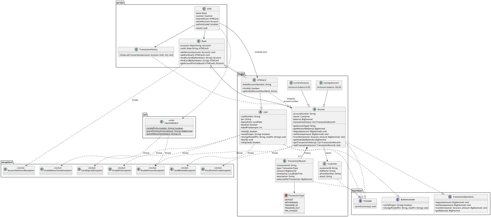

# ATM Simulation System (Java OOP Project)

A console-based ATM simulation written in plain Java. A customer inserts a card, logs in with a
4-digit PIN, and then checks a balance, deposits, withdraws, transfers money, views recent
transactions, or changes the PIN. The project is built to make core object-oriented programming
concepts easy to see and explain in code.

> **Academic simulation only.** It does not connect to any bank, does not use real card data, and
> does not implement real financial security. PINs are stored and shown in plain text purely for
> classroom demonstration. A real system must never do that.

---

## Table of contents

1. [Features](#features)
2. [OOP concepts demonstrated](#oop-concepts-demonstrated)
3. [Package structure](#package-structure)
4. [Class descriptions](#class-descriptions)
5. [Requirements](#requirements)
6. [Compile and run](#compile-and-run)
7. [Demo credentials](#demo-credentials)
8. [Business rules](#business-rules)
9. [Sample console session](#sample-console-session)
10. [Test cases](#test-cases)
11. [UML class diagram](#uml-class-diagram)
12. [Limitations](#limitations)
13. [Future improvements](#future-improvements)

---

## Features

- Card selection with validation: unknown, **blocked**, and **expired** cards are rejected before any PIN is asked.
- PIN login with exactly 4 digits, a maximum of **3 failed attempts**, and **automatic card blocking**.
- Check balance (also shows how much can be withdrawn after the minimum balance).
- Deposit, withdraw, and transfer between accounts, with minimum-balance rules per account type.
- Every completed deposit, withdrawal, transfer (out and in) and PIN change is recorded.
- View the **last 5 transactions, newest first**.
- Change PIN (the old PIN is verified first).
- Input validation everywhere: bad menu choices, bad amounts, wrong PINs, and unknown accounts show a
  friendly message and the program keeps running. No stack traces for expected mistakes.
- If the input stream ends (Ctrl+D / piped input runs out), the ATM shuts down cleanly.

---

## OOP concepts demonstrated

| Concept | Where to find it | What to point at |
|---|---|---|
| **Encapsulation** | `model/Account.java`, `model/Card.java`, `service/Bank.java` | All fields are `private`. `Account` has **no `setBalance()`**; the balance changes only through `deposit`, `withdraw` and `transfer`. `Card` has **no PIN getter**, and its blocked flag and attempt counter change only through PIN checks or `block()`. `Bank` never exposes its internal maps. `getTransactionHistory()` returns a read-only view. |
| **Abstraction** | `Account`, `Card` | `abstract class Account` (abstract `getAccountType()` and `getMinimumBalance()`) and `abstract class Card` (abstract `isValid()`). Neither can be instantiated. |
| **Inheritance** | `SavingsAccount`, `CurrentAccount`, `ATMCard` | `Account` ← `SavingsAccount`, `CurrentAccount`; `Card` ← `ATMCard`. |
| **Interfaces** | `interfaces/` | `Authenticatable` (implemented by `Card`), `TransactionOperations` (implemented by `Account`), `Printable` (implemented by `Account`, `Card`, `Customer`, `TransactionRecord`). |
| **Polymorphism** | `app/Main.java`, `service/Bank.java`, `service/ATM.java` | `Account savings = new SavingsAccount(...)` and `Account current = new CurrentAccount(...)` are used through the same `Account` type. The overridden `getAccountType()` / `getMinimumBalance()` change the behaviour of `withdraw` and `transfer`. `ATMCard` overrides `isValid()` and `printSummary()`. |
| **Custom exception handling** | `exceptions/` (7 checked exceptions) | Thrown by `Account`, `Card`, `Bank` and `InputValidator`; caught with `try/catch` (including multi-catch) in `ATM`, which turns each one into a friendly message. |
| **Collections** | `Bank`, `Account`, `TransactionHistory` | `HashMap<String, Account>` and `HashMap<String, ATMCard>` for lookup; `ArrayList<TransactionRecord>` for history. |
| **Clean package structure** | `src/` | `app`, `model`, `service`, `interfaces`, `exceptions`, `util`, each with one responsibility. |

---

## Package structure

```text
ATM-Simulation-System/
├── src/
│   ├── app/
│   │   └── Main.java
│   ├── model/
│   │   ├── Account.java            (abstract)
│   │   ├── SavingsAccount.java
│   │   ├── CurrentAccount.java
│   │   ├── Card.java               (abstract)
│   │   ├── ATMCard.java
│   │   ├── Customer.java
│   │   ├── TransactionRecord.java
│   │   └── TransactionType.java    (enum)
│   ├── service/
│   │   ├── ATM.java
│   │   ├── Bank.java
│   │   └── TransactionHistory.java
│   ├── interfaces/
│   │   ├── Authenticatable.java
│   │   ├── TransactionOperations.java
│   │   └── Printable.java
│   ├── exceptions/
│   │   ├── InvalidAmountException.java
│   │   ├── InsufficientFundsException.java
│   │   ├── InvalidPinException.java
│   │   ├── CardBlockedException.java
│   │   ├── CardExpiredException.java
│   │   ├── AccountNotFoundException.java
│   │   └── InvalidMenuChoiceException.java
│   └── util/
│       └── InputValidator.java
├── README.md
└── .gitignore
```

---

## Class descriptions

### `app`
| Class | Purpose |
|---|---|
| `Main` | Entry point. Builds the demo customers, accounts and cards, registers them with a `Bank`, then starts the `ATM`. Contains no business logic. |

### `model`
| Class | Purpose |
|---|---|
| `Account` (abstract) | Common account behaviour: private balance, deposit, withdraw, transfer, validation, transaction recording. Subclasses supply the account type name and minimum balance. |
| `SavingsAccount` | Savings account. Minimum balance **100.00**. |
| `CurrentAccount` | Current account. Minimum balance **0.00**; no overdraft. |
| `Card` (abstract) | Common card behaviour: PIN verification and change, failed-attempt counting, blocking, expiry. Subclasses define what "valid" means. |
| `ATMCard` | A card linked to exactly one account; `isValid()` checks blocked state, then expiry. |
| `Customer` | Immutable customer details (ID, name, phone, email). |
| `TransactionRecord` | Immutable record of one completed action: ID, type, amount, timestamp, description, balance afterwards. |
| `TransactionType` | Enum: `DEPOSIT`, `WITHDRAWAL`, `TRANSFER_IN`, `TRANSFER_OUT`, `PIN_CHANGE`. |

### `service`
| Class | Purpose |
|---|---|
| `ATM` | The console controller: card selection, PIN login, menu loop, and each operation. Uses only public methods of other classes. |
| `Bank` | In-memory repository of accounts and cards with lookup and the account-to-card relationship. |
| `TransactionHistory` | Prints the latest N transactions, newest first, without modifying the original list. |

### `interfaces`
| Interface | Purpose |
|---|---|
| `Authenticatable` | `verifyPin(String)` and `changePin(String, String)`. |
| `TransactionOperations` | `deposit`, `withdraw`, `transfer`, `getBalance`. |
| `Printable` | `printSummary()`. |

### `exceptions` (all checked, extending `Exception`)
| Exception | Thrown when |
|---|---|
| `InvalidAmountException` | An amount is empty, not numeric, zero, negative, has more than 2 decimals, or a transfer targets the same account. |
| `InsufficientFundsException` | A withdrawal or transfer would drop the balance below the minimum. Carries the available and requested amounts. |
| `InvalidPinException` | A PIN is malformed or incorrect (also when verifying on a blocked card). |
| `CardBlockedException` | A blocked card is used. |
| `CardExpiredException` | An expired card is used. |
| `AccountNotFoundException` | A card or account cannot be found (or a card's linked account is not registered). |
| `InvalidMenuChoiceException` | A menu entry is empty, not a whole number, or outside 1-7. |

### `util`
| Class | Purpose |
|---|---|
| `InputValidator` | `final` utility class that centralises parsing and validation of PINs, amounts and menu choices. |

---

## Requirements

- **JDK 17 or newer** (recommended). The code uses no language features newer than Java 11 syntax,
  but it was only compiled and run on **JDK 21**; compiling on Java 11 has not been tested.
- No external libraries and no build tool required.

---

## Compile and run

From the project root (the folder containing `src/`):

```bash
javac -d out src/app/Main.java src/model/*.java src/service/*.java src/interfaces/*.java src/exceptions/*.java src/util/*.java
java -cp out app.Main
```

**Alternative that avoids long wildcard lists** (Linux / macOS / Git Bash):

```bash
find src -name "*.java" > sources.txt
javac -d out @sources.txt
java -cp out app.Main
```

On Windows Command Prompt, create the file list with `dir /s /b src\*.java > sources.txt`, then
run the same `javac` and `java` commands. This works as long as the project path contains no spaces.

**IDE (IntelliJ IDEA, Eclipse, VS Code):** open the folder, mark `src` as the sources root, and run
`app.Main`. Type your input into the IDE's run/console window.

**Quick non-interactive smoke test** (the prompts run together because piped input is not echoed):

```bash
printf 'CARD1001\n1234\n1\n7\nEXIT\n' | java -cp out app.Main
```

> The bank's data lives only in memory. **Restart the program to reset everything**, including
> balances and blocked cards.

---

## Demo credentials

These are classroom test values only.

| Customer | Account | Type | Opening balance | Card | PIN | Expiry | Purpose |
|---|---|---|---:|---|---|---|---|
| Aarav Sharma | ACC1001 | Savings | 5000.00 | CARD1001 | 1234 | 2028-12-31 | Normal use |
| Priya Patel | ACC1002 | Current | 12000.00 | CARD1002 | 5678 | 2028-06-30 | Normal use, transfer receiver |
| Rahul Verma | ACC1003 | Savings | 800.00 | CARD1003 | 4321 | 2025-01-01 | **Expired card** test |
| Neha Iyer | ACC1004 | Savings | 1500.00 | CARD1004 | 9999 | 2028-12-31 | **Pre-blocked card** test |

Phone numbers and email addresses in `Main` are made-up placeholders.

---

## Business rules

**PIN and card**
- A PIN is exactly 4 digits.
- **Every** failed PIN entry counts as an attempt, including a malformed one such as `abc` or `12`.
- The 3rd failed attempt blocks the card and ends the session. A successful login resets the counter to 0.
- A blocked card is rejected even with the correct PIN.
- A card is valid **through** its expiry date; it is expired the day after. Blocked is checked before expired.
- Changing the PIN verifies the old PIN first. A wrong old PIN also counts as a failed attempt.
  A malformed new PIN is rejected without using up an attempt.

**Money**
- All money uses `BigDecimal`, never `double`.
- An amount must be greater than zero and have at most 2 decimal places. `10.005` is rejected, not rounded.
- **Savings** accounts must always keep at least **100.00**. **Current** accounts must keep at least
  **0.00**. There is no overdraft.
- A transfer is all-or-nothing: if any check fails, neither account changes.
  The sender gets a `TRANSFER_OUT` record and the receiver a `TRANSFER_IN` record.
  Transferring to your own account is rejected.

**History**
- Completed deposits, withdrawals, transfers and PIN changes are recorded. Failed attempts are not.
- "Last 5 transactions" shows up to 5 records, newest first, based on the order they happened.

**Lookups**
- Card and account numbers ignore case and surrounding spaces (`card1001` finds `CARD1001`).

**Navigation**
- Option 7 ejects the card and returns to the card prompt. Type `EXIT` at the card prompt to shut down.

---

## Sample console session

This is a real run (the repeated ATM menu is trimmed for readability). Timestamps reflect the day the
sample was captured.

```text
====================================
     WELCOME TO JAVA ATM SYSTEM
====================================

Available demo card numbers: CARD1001, CARD1002, CARD1003, CARD1004
Enter card number (or EXIT to shut down): CARD1001
Card CARD1001 accepted.
Enter 4-digit PIN: 9999
Incorrect PIN. 2 attempt(s) remaining.
Enter 4-digit PIN: 1234

Login successful. Welcome, Aarav Sharma!

====================================
             ATM MENU
====================================
1. Check Balance
2. Deposit Money
3. Withdraw Money
4. Transfer Money
5. View Last 5 Transactions
6. Change PIN
7. Eject Card / Exit
====================================
Enter your choice: 1
Account         : ACC1001 (Savings Account)
Current balance : 5000.00
Available to withdraw: 4900.00

[... ATM menu is shown again ...]
Enter your choice: 2
Enter deposit amount: 500
Deposit successful. Current balance: 5500.00

[... ATM menu is shown again ...]
Enter your choice: 3
Enter withdrawal amount: 1000
Withdrawal successful. Current balance: 4500.00

[... ATM menu is shown again ...]
Enter your choice: abc
Invalid choice: Please enter a whole number.

[... ATM menu is shown again ...]
Enter your choice: 4
Enter receiver account number: ACC1002
Enter transfer amount: 500
Transfer successful. Sent 500.00 to ACC1002. Current balance: 4000.00

[... ATM menu is shown again ...]
Enter your choice: 5
Last 3 transaction(s) for account ACC1001 (newest first):
TXN-1003 | TRANSFER_OUT | Amount: 500.00 | Balance: 4000.00 | 2026-10-01 07:54
TXN-1002 | WITHDRAWAL | Amount: 1000.00 | Balance: 4500.00 | 2026-10-01 07:54
TXN-1001 | DEPOSIT | Amount: 500.00 | Balance: 5500.00 | 2026-10-01 07:54

[... ATM menu is shown again ...]
Enter your choice: 7
Card ejected. Thank you for using Java ATM.

Available demo card numbers: CARD1001, CARD1002, CARD1003, CARD1004
Enter card number (or EXIT to shut down): EXIT

Thank you for using Java ATM. Goodbye!
```

---

## Test cases

Run each case on a **fresh start** of the program, because balances and blocked cards are kept in memory.
Entries on separate lines are typed one after another.

| ID | Scenario | Steps (what you type) | Expected result |
|---|---|---|---|
| TC-01 | Successful login | `CARD1001`, `1234` | `Login successful. Welcome, Aarav Sharma!` and the ATM menu appears. |
| TC-02 | Incorrect PIN once | `CARD1001`, `9999`, then `1234` | `Incorrect PIN. 2 attempt(s) remaining.` then login succeeds; the counter is reset. |
| TC-03 | Three incorrect PINs | `CARD1001`, then `1111`, `2222`, `3333` | On the 3rd: `Incorrect PIN. Card has been blocked after 3 failed attempts.` then `Session ended.` Entering `CARD1001` again shows the blocked message. |
| TC-04 | Expired card | `CARD1003` | `Card CARD1003 expired on 2025-01-01.` No PIN is requested. |
| TC-05 | Blocked card | `CARD1004` | `Card CARD1004 is blocked. Please contact your bank.` No PIN is requested. |
| TC-06 | Valid deposit | Log in with `CARD1001`/`1234`, then `2`, `500` | `Deposit successful. Current balance: 5500.00`. Option `5` lists the `DEPOSIT`. |
| TC-07 | Invalid deposit | Menu `2`, then `-50` (repeat with `0`, then `abc`) | `-50` and `0`: `Deposit failed: Amount must be greater than zero.` `abc`: `Deposit failed: Amount must be a number such as 500 or 250.75 (digits only).` Balance is unchanged. |
| TC-08 | Valid withdrawal | Log in with `CARD1001`/`1234`, then `3`, `1000` | `Withdrawal successful. Current balance: 4000.00`. History shows `WITHDRAWAL`. |
| TC-09 | Insufficient withdrawal | Menu `3`, then `4900.01` | `Withdrawal failed: Insufficient funds. Available: 4900.00, requested: 4900.01`. (Savings must keep 100.00.) |
| TC-10 | Valid transfer | Menu `4`, `ACC1002`, `500` | `Transfer successful. Sent 500.00 to ACC1002. Current balance: 4500.00`. Eject, log in as `CARD1002`/`5678`, option `5` shows `TRANSFER_IN` with balance 12500.00. |
| TC-11 | Invalid receiver | Menu `4`, `ACC9999` | `Transfer failed: Account ACC9999 was not found.` No amount is requested; no money moves. |
| TC-12 | PIN change | Menu `6`, current `1234`, new `4444`; eject (`7`); log in again with `4444` | `PIN changed successfully.` The new PIN works; `1234` is now rejected. |
| TC-13 | Invalid menu input | At the menu type `abc`, then `99` | `Invalid choice: Please enter a whole number.` / `Invalid choice: Please choose a number between 1 and 7.` The menu is shown again and the ATM keeps running. |
| TC-14 | View history | Do several deposits / withdrawals, then menu `5` | `Last N transaction(s) for account ACC1001 (newest first):` with at most 5 lines, newest first. With no activity: `No transactions found for account ACC1001 yet.` |

Other inputs that are handled without crashing: empty input, `0`, `-1`, `999999`, very long numbers,
amounts like `1e3` or `1,000`, unknown or blank card numbers, a card whose account is missing, and the
input stream ending at any point.

This repository contains no automated test suite; the cases above are a manual test guide.
Adding JUnit tests is listed under [Future improvements](#future-improvements).

---

## UML class diagram

### Simplified diagram (ASCII)

Card side:

```text
        <<interface>>                      <<interface>>
        Authenticatable                    Printable
        + verifyPin(pin)                   + printSummary()
        + changePin(old, new)
               ^                                  ^
               | implements                       | implements
               +----------------+-----------------+
                                |
                        <<abstract>> Card
                        - cardNumber : String
                        - pin : String
                        - expiryDate : LocalDate
                        - blocked : boolean
                        - failedPinAttempts : int
                        + isValid() : boolean   {abstract}
                        + verifyPin() / changePin() / block()
                                ^
                                | extends
                             ATMCard
                        - linkedAccountNumber : String
                        + isValid() : boolean
```

Account side:

```text
        <<interface>>                      <<interface>>
        TransactionOperations              Printable
        + deposit(amount)                  + printSummary()
        + withdraw(amount)
        + transfer(receiver, amount)
        + getBalance()
               ^                                  ^
               | implements                       | implements
               +----------------+-----------------+
                                |
                      <<abstract>> Account
                      - accountNumber : String
                      - owner : Customer
                      - balance : BigDecimal
                      - transactionHistory : List<TransactionRecord>
                      + getAccountType() : String        {abstract}
                      + getMinimumBalance() : BigDecimal {abstract}
                      + deposit() / withdraw() / transfer()
                                ^
                                | extends
                  +-------------+--------------+
                  |                            |
            SavingsAccount               CurrentAccount
            minimum balance 100.00       minimum balance 0.00
```

`Customer` and `TransactionRecord` also implement `Printable`.

Relationships between the main classes:

```text
 Main ------> Bank
 Main ------> ATM
 ATM  ------> Bank ------> Account   (HashMap<String, Account>)
 ATM  ------> ATMCard                (inserted card)
 Bank ------> ATMCard                (HashMap<String, ATMCard>)
 ATM  ------> TransactionHistory ------> Account
 ATM  ------> InputValidator
 ATMCard ---- links to ---- Account by account number
 Account --*  TransactionRecord      (1 account owns 0..* records)
 Account -->  Customer               (owner)
 TransactionRecord --> TransactionType
```

Checked exceptions and who throws them:

```text
 Account    : InvalidAmountException, InsufficientFundsException
 Card       : InvalidPinException, CardBlockedException, CardExpiredException
 Bank       : AccountNotFoundException
 InputValidator : InvalidAmountException, InvalidMenuChoiceException
 ATM        : catches all of the above and prints a friendly message
```

### PlantUML source

Paste this into any PlantUML renderer (for example an IDE plugin, or the PlantUML web server) to
draw the diagram. The text below has not been rendered in the environment where the project was built,
so check it in your renderer.



---

## Limitations

- **In-memory only.** Nothing is saved; all data is rebuilt each time the program starts.
- **PINs are plain text** and are **echoed as you type**. Console masking is not attempted because it is
  not reliable across IDEs and JDK versions. A real system stores only salted hashes and never shows PINs.
- One account per card, and the demo data is fixed in `Main`.
- No overdraft, no daily withdrawal limit, no interest, no currency or fees.
- Timestamps are shown to the minute, so ordering in the history relies on the order records were created.
- Single-user and single-threaded: it is not designed for concurrent access.
- No automated tests are included. The project was developed and run on JDK 21 only.

---

## Future improvements

These are optional extras that were intentionally left out of the core project:

- Save accounts and transactions to text/CSV files.
- Account statement export.
- Daily withdrawal limit.
- Multiple accounts per customer, with account selection after login.
- Session timeout.
- Administrator mode for creating customers, accounts and cards (and unblocking cards).
- JUnit tests for `Account`, `Card` and `InputValidator`.
- Optional overdraft limit for current accounts.
- A Swing or JavaFX graphical interface.
- Hashing PINs instead of storing them in plain text.
